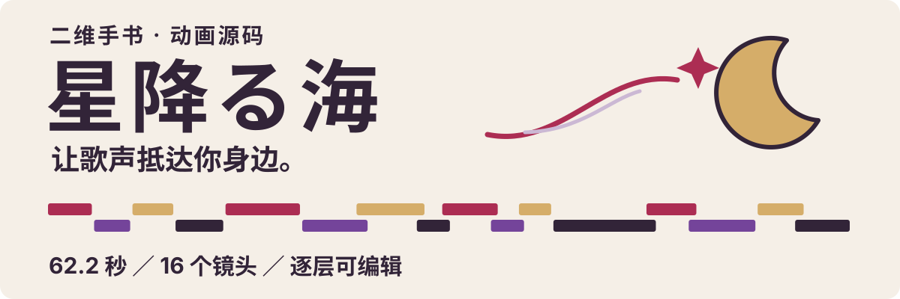

<p align="center">
  
</p>

<p align="center">
  <a href="https://github.com/Freakz2z/kaguya-pv/actions/workflows/source-check.yml"></a>
  · <a href="LICENSE">MIT · 自有代码</a>
  · <a href="docs/ARCHITECTURE.md">结构说明</a>
  · <a href="docs/ASSETS.md">素材说明</a>
</p>

# 星降る海 · 二维手书 PV 源码

把一部《超かぐや姫！》同人 PV 的制作过程，整理成可以运行、拆解和修改的动画工程：**文字如何入场，画面如何交接，音符如何穿过场景，鼓点如何带动整个版面。**

最终工程为 **62.2 秒 / 1920×1080 / 30 fps**。HyperFrames 组织时间线，GSAP 驱动动画，Canvas 绘制烟花、泡泡与音符拖尾，Python 生成分层镜头与音乐落点。首页图中的色条按实际镜头的起止时间绘制。

> **你会看到什么：**开源版提供动画代码与可运行演示，默认使用几何占位图、静音音轨、示例字幕和系统字体。人物画稿、原曲、官方图像与完整歌词不随仓库分发，因此默认预览与成片的美术和听感不同。持有原工程者可[在本地还原完整预览](#本地还原完整预览)。

## 先跑起来

准备 **Node.js 22+**。预览与浏览器检查还需要系统中的 **FFmpeg** 和可用浏览器。

```sh
git clone https://github.com/Freakz2z/kaguya-pv.git
cd kaguya-pv
npm ci
npm run dev
```

打开命令输出的 HyperFrames Studio 地址，即可播放、拖动时间轴，查看独立镜头与图层。默认演示没有音乐，这是预期行为。

`npm ci` 自动生成 42 张同尺寸占位图、覆盖原音乐源偏移的 240 秒静音 WAV，并从锁文件指定的依赖复制 GSAP。生成物都在 Git 忽略目录。首次预览通过 `npx` 获取固定版本的 **HyperFrames 0.8.162**；GSAP 固定为 **3.14.2**，需要联网安装。

## 可以从这里学到什么

| 演出 | 实现与入口 |
| --- | --- |
| 文字成为画面主体 | 字组入场、遮罩揭示、前后景切换，见 [typography.py](source/revision-v31/typography.py) |
| 跟随鼓点的缩放脉冲 | 主文字、装饰和字幕分别控制，见 [pulses.py](source/revision-v31/pulses.py) |
| 声音跨越多个场景 | 音符轨迹与拖尾，见 [journey.py](source/revision-v25/journey.py) 和 [journey-trails.js](source/revision-v25/journey-trails.js) |
| 镜头之间的交接 | 遮挡、形状揭示、三色块转场，见 [transitions.py](source/revision-v27/transitions.py) |
| 场景与字幕分开编辑 | 单行布局、颜色过渡和鼓点响应，见 [subtitles.py](source/revision-v22/subtitles.py) |
| 动画可以随时拖动 | 暂停的 GSAP 时间线、直接按时间采样的 Canvas，见 [fireworks.js](source/revision-v22/fireworks.js) |

这是完成制作后的具体作品工程，适合参考和拆解，没有抽象成通用动画编辑器。

## 工程怎么组织

```text
index.html                 主时间线、音轨与镜头挂载
compositions/              逐镜 HTML、字幕、全片转场
source/build.py            构建入口，保护未同步的 Studio 改动
source/revision-*/         最终工程仍在使用的演出模块
config/                    素材尺寸与原版快照摘要
scripts/                   安装、仓库审计、本地还原工具
assets/readme/             首页静态 SVG
assets/fonts/              附 OFL 许可的中文字体子集
docs/                      架构、素材边界、验证和发布记录
```

主时间线挂载 **16 个内容镜头**，字幕和全片转场另外独立。镜头内部按背景、后景文字、人物、前景特效、主文字和转场分层；生成器以帧定位事件，再换算为秒。

`revision-*` 是制作过程中保留的模块目录名，属于同一个最终构建的依赖，**不是需要逐个执行的版本**。完整说明见 [ARCHITECTURE.md](docs/ARCHITECTURE.md)。

## 修改与重建

可在 Studio 或 HTML 中调整镜头。希望通过 Python 重建时，准备 **Python 3.11+** 再安装构建依赖；只预览不需要 Python。macOS 自带的 Python 3.9 不满足要求，可先安装新版 Python：

```sh
python3 -m venv .venv
source .venv/bin/activate
python -m pip install -r source/requirements-build.txt
npm run build
npm run check
```

Windows PowerShell 使用 `.\.venv\Scripts\Activate.ps1` 激活环境；也可直接使用 `.\.venv\Scripts\python.exe source/build.py` 构建。

**先保存 Studio 的修改，再重建。** 构建器检查 `source/generated-files.json`：发现 HTML 被外部修改就拒绝覆盖。先把需要保留的调整同步回生成代码并提交；确认完成后，才使用 `python source/build.py --overwrite-edited`。

| 命令 | 用途 |
| --- | --- |
| `npm run dev` | 打开前台预览 |
| `npm run setup` | 补齐缺失的演示资源，保留已有占位图 |
| `npm run build` | 由 Python 重建时间线与镜头 |
| `npm run check` | HyperFrames 运行、布局、对比度等检查 |
| `npm run audit:repo` | 检查 Git 跟踪文件与资源依赖 |

Python 依赖版本见 [requirements-build.txt](source/requirements-build.txt)。运行 `python3 --version` 确认选中的解释器至少为 3.11；日语字体使用系统回退，跨系统的字形与文字测量可能有差异。

## 换成自己的作品

可从一两个镜头开始：替换图像、调整剧情短句、重设音符轨迹，再按自己的音乐重新标注鼓点和字幕。更换音乐后，需要重新听审落点。

图像路径和尺寸见 [config/assets.json](config/assets.json)，占位图生成逻辑见 [scripts/setup.mjs](scripts/setup.mjs)。音乐轨道保留了原工程 **169.1 秒**的源偏移和画面内 **20.5–23.1 秒**的停顿；更换曲目时一起调整源偏移、停顿与结束时间。

请使用自己的美术、音乐、字体，或有明确使用条件的资源。生成的占位图、音频、运行库和私有素材目录不进入 Git。

## 本地还原完整预览

仅适用于持有最终原工程的作者或使用者；普通克隆不需要这一步。

```sh
python3 scripts/import_private.py ../path-to-original-project
npm run dev:private
```

导入器先核验原 HTML 的 SHA-256，再把实际引用的文件复制到被 Git 忽略的 `.private-preview/`。公开演示源码保持独立。它不会下载原曲，也不会覆盖已经存在的私有预览。

## 验证与边界

- 已验证干净 Git 副本的安装、资源生成、Python 编译与重建，以及连续重建的字节一致性。
- 已验证构建器会拦截尚未同步的 Studio 修改。
- 本地 HyperFrames 检查覆盖 16 个时间采样；运行与布局无错误。字幕轨道较密的维护提醒保留在记录中。
- GitHub Actions 覆盖安装、仓库审计、Python 编译与构建。检查范围及报告见 [VALIDATION.md](docs/VALIDATION.md)。

这些检查验证工程结构和运行情况。占位版不用于验收人物手势、美术一致性或音乐听感，也未配置逐动作的 motion sidecar 断言。

## 制作与致谢

**制作：Freakz2z。** AI 参与创意整理、画稿生成与修订、动画代码和动态排版；制作过程使用 Codex、ImageGen、HyperFrames、GSAP、Canvas、Python 和 FFmpeg。

- 原作：《超かぐや姫！》。本项目为非官方同人创作。
- 音乐：**Aqu3ra／月見ヤチヨ（cv.早見沙織）—《星降る海》**。参见[官方 MV](https://www.youtube.com/watch?v=h5XQqKuek5A)，音乐不随仓库分发。
- 演出参考：[【超时空辉夜姬/手书】へんしん!](https://www.bilibili.com/video/BV1nYZ3BCEHL/)。

## 许可

自有代码采用 [MIT License](LICENSE)。HyperFrames 改编部分、GSAP 与中文字体按各自许可执行，详见 [NOTICE.md](NOTICE.md) 和 [LICENSES/](LICENSES/)。

代码许可不授予原作角色、音乐、歌词、商标或官方画面的权利。未附许可的用户烟花模板没有进入公开源码，开源版使用独立演示实现。素材明细见 [ASSETS.md](docs/ASSETS.md)。

项目已结束制作，作为源码与制作记录保留。问题反馈和修改建议请附镜头编号、时间点、复现步骤，参见 [CONTRIBUTING.md](CONTRIBUTING.md)。
